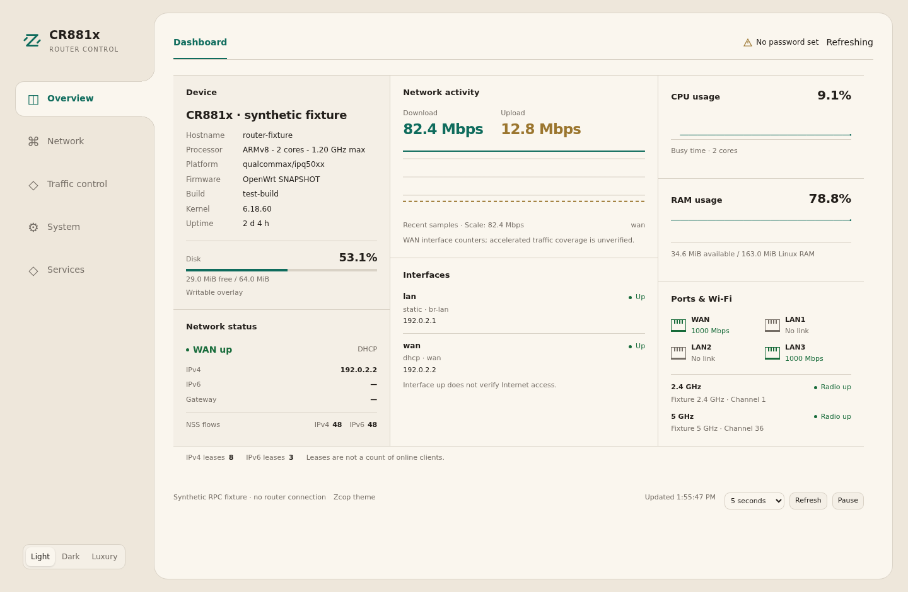

# Zcop LuCI theme

An independent OpenWrt/ImmortalWrt feed with a warm light palette, a charcoal
dark palette and a black/gold luxury palette. The selected sidebar item joins
the main frame as one continuous surface. Fonts and icons are local; no CDN,
wallpaper download, extra daemon or framework is required.

The sidebar and section menu stay in place while the main content frame scrolls.
The outer frame keeps the same width and height across pages at a given viewport.
Forms use the available content space; tables wider than that space scroll
horizontally inside the content frame, leaving both menus in place.
Long navigation lists scroll independently only when needed to keep every page
reachable on a short viewport. The firmware/version and theme-credit footer stays outside the main frame,
anchored below it in the viewport shell. It stays visible while content scrolls.
Dashboard refresh controls and page save/apply controls keep their own footer
inside the content frame. The internal control host also retains the historic
footer selector so older cached Dashboard modules keep their controls inside.



Application rendered with synthetic test data; these are not live router values.

## Packages

| Package | Purpose |
| --- | --- |
| `luci-theme-zcop` | Theme, connected sidebar, registered LuCI page menus, three browser-local palettes and mobile navigation. |
| `luci-app-zcop-dashboard` | Dashboard, Devices and Wireless: resource/network overview, passive device details, explicit DHCP staging, and manual channel analysis. |

The theme depends on `luci-theme-bootstrap` to preserve LuCI's established form,
authentication, modal, save/apply and rollback contracts. No LuCI core patch or
ImmortalWrt fork is needed. Current templates target modern ucode-based LuCI;
legacy Lua-only LuCI is not supported.

Form controls and opened LuCI dropdowns follow the selected palette, including
search fields, focus/error states and compact footer buttons. Shared action rows
use explicit 8-pixel gaps, including modal footers, table buttons, inline field
actions and dynamic-list add controls. Controls wrap when needed; native split
buttons remain a single joined control. Supported desktop
browsers also use themed native select pickers; other browsers retain their
native picker behaviour. This styling adds no JavaScript widget replacement,
router service or polling.

## Add the feed

Add this line once to the firmware tree's `feeds.conf.default` (or its active
`feeds.conf`):

```text
src-git zcoptheme https://github.com/zcop/luci-theme-zcop.git;main
```

Then run from that firmware tree:

```sh
./scripts/feeds update zcoptheme
./scripts/feeds install -p zcoptheme luci-theme-zcop luci-app-zcop-dashboard
make menuconfig
```

Select the theme under **LuCI → Themes** and, optionally, the dashboard under
**LuCI → Applications**. To compile only these packages in an already prepared
build tree:

```sh
make package/feeds/zcoptheme/luci-theme-zcop/compile V=s
make package/feeds/zcoptheme/luci-app-zcop-dashboard/compile V=s
```

There is no prebuilt package repository yet. The Git feed downloads source for
OpenWrt's package builder; it is not an `apk`/`opkg` binary feed. The package
directories can also be symlinked into another prepared build tree.

## Select the theme

Installing registers **Zcop** under LuCI's language/style settings and selects
it as the default once. The registration script runs after Bootstrap and Argon.
Later upgrades preserve your manual theme choice, using the
`luci.main.zcop_default_applied` marker. To select Zcop manually on the router:

```sh
uci set luci.main.mediaurlbase='/luci-static/zcop'
uci commit luci
```

Reload the browser. Palette selection stays in that browser's local storage;
it does not write router configuration. To return to Bootstrap, select it in
LuCI or set the media path to `/luci-static/bootstrap`. Authentication and
save/apply still use LuCI's own handling.

## Wireless overview

**Overview → Wireless** shows reported operating channel and width, associated
AP-client count, weakest-client/uplink RSSI, noise and busy airtime for each
radio. Radios without an active network show configured channels separately;
configuration is never presented as an operating channel. Missing station or
survey data stays unavailable. Busy airtime includes the router's own traffic,
so it is not labelled an interference percentage.

**Scan nearby networks** runs one explicit scan on the selected radio. It may
briefly pause Wi-Fi traffic. A lightweight SVG graph shows overlapping occupied
spectrum and signal strength, with a local-network list and a table of nearby
BSSIDs. No configuration changes are sent; use **Network → Wireless** to choose
a channel through LuCI's normal validation. A client or mesh link may follow
its upstream peer's channel.

The advisory ranks legal channel blocks by summed signal power weighted by
the fraction of overlapping spectrum. Advertised 40/80/160/80+80 MHz footprints
are considered, with an explicit approximate 20 MHz fallback when width is
unknown. 2.4 GHz compares 1/6/11 at 20 MHz. Wider 5/6 GHz blocks require every
20 MHz subchannel to be available with compatible width flags. Restricted
channels are excluded; DFS candidates are labelled. Exact ties prefer a
non-DFS block, then the current primary channel. Multiple BSSIDs can belong
to one AP; this remains a visibility estimate, not measured airtime or a speed
guarantee. Empty, failed, stale or unusable scans never produce a recommendation.
Suggestions expire after five minutes. Hidden transmitters, non-Wi-Fi noise,
beacon omissions and incomplete scan coverage can affect the result.

Status reads and scans are manual. The page adds no daemon, auto-scan, router-side
history or background collector. Only the explicitly granted `iwinfo.scan`
write capability enables scanning. Configuration and radio restart APIs are not
granted. Channel legality uses a fixed read-only `iw phy phyN channels` command
through the existing LuCI file RPC, restricted to one- or two-digit PHY IDs;
no shell, arbitrary executable, arbitrary arguments or environment is allowed.
The parser respects disabled/no-IR/radar-unavailable channels and explicit width
capabilities. Other observations use existing LuCI/iwinfo read RPCs. Numeric/scan snapshots remain bounded in browser memory. This avoids a local
libiwinfo defect that can mix stale buffer bits into frequency restrictions;
firmware libraries and LuCI core are left unchanged.

The optional dashboard appears under **Overview → Dashboard**. Overview shows
Dashboard, Devices and Wireless when those pages are installed and permitted. Other status pages
are grouped by their purpose:

| Navigation | Pages |
| --- | --- |
| System | Logs (System/Kernel subpages when registered), Processes |
| Network → Diagnostics | Connectivity tools, Routing table, Firewall status, Channel analysis, WireGuard status when installed/permitted |
| System → Diagnostics | Other installed status plugins, preserving their subpages |
| Hidden for now | Legacy Overview, Realtime Graphs |

All links use existing backend URLs and access checks. Hidden pages remain
registered; no core route or package is removed. Native application subpages,
status aliases and QoS grouping stay accessible. When Dashboard is unavailable
or not permitted, the original status menu remains the fallback. Diagnostic
views are loaded only when opened; menu rendering does not run probes or scans.

**System → System** uses a single properties frame. Device identity, clock,
interface preferences, logging, time service and time sources sit in connected
sections instead of separate property tabs. Repeated page headings and obvious
helper text are removed; help that changes a setting's meaning remains. The
default layout targets one-screen use at 1920×1080 and above. Narrower frames
stack sections and keep scrolling inside the main frame.

The theme rearranges the existing native LuCI field nodes within their original
form/section containers. Validation, dependency handling, read-only state,
Reset, time synchronization actions and Save/Apply use their original handlers.
Unknown future fields remain visible. A small page-specific browser observer
reapplies the layout after native form rendering/Reset; it adds no RPC, UCI
write, polling or router service. Other themes retain the native System page.

When the existing root-password check reports no password, a compact **No
password set** notice appears in the fixed top bar, with a link to password
settings when that page is permitted. It does not occupy dashboard content.

The dashboard uses its own presentation over existing authenticated LuCI RPC
data. It uses connected panes with shared divider lines: device details and disk on
the left, compact WAN activity/status in the center, and CPU/RAM trends plus
ports/radios on the right. A wider interface table spans the left and center
below those summaries, with compact rows for additional VPN/tunnel interfaces. A quiet background separates
the device pane without rounded cards. Panes reflow as the frame narrows.
Refresh controls sit in the page footer. CPU/RAM sections retain their size
through pending/error states. Processor architecture, present-core count and
maximum frequency are read once per page; unavailable fields are not guessed.
Detailed configuration stays on the existing pages. Missing data is shown as
unavailable; an interface being up does not claim Internet reachability, and
lease counts do not claim that clients are online.

Dashboard ports show one current-role label, following **WAN Mode** assignments:
WAN1/WAN2 or LAN1/LAN2/LAN3/LAN4. Existing LAN numbering stays stable; the fourth
socket becomes LAN4 when assigned to LAN. Physical device IDs remain internal
and available in the tooltip, independently of carrier/speed. Port links open the
existing WAN Mode page when that page is permitted. The Dashboard only reads
status: it never applies port changes. Role snapshots refresh with device status
every15 seconds while visible. An absent/failed WAN Mode app shows Unknown;
shared VLAN sockets and conflicting untagged assignments are labelled separately.

**Overview → Devices** merges DHCPv4/v6 leases, configured static reservations,
IPv4/v6 neighbours, learned MACs and local AP associations. It keeps unobserved
static entries and saved names, groups explicit MAC/DUID identities, and supports
search, source filters and 50-row pages. IP reuse alone does not merge devices.
STALE describes a cached neighbour, not a device known to be offline.

**Seen via LAN2** means that the forwarding table learned the MAC through that
router port. It does not distinguish a directly attached client from a wired or
wireless client behind a downstream switch/AP. Only associations reported by
this router's running AP interfaces show **Local Wi-Fi**, SSID, band, signal and
Tx/Rx radio link rates. Those rates are not throughput. Failed snapshots retain
an explicit cached label and hide old radio readings; successful empty snapshots
clear the association. Private switch transport VLANs are not user VLAN labels.

The row's **Actions** menu can copy MACs/addresses, set a friendly display name,
create an IPv4 reservation or edit a simple existing reservation. Friendly names
live in the small UCI `zcop_devices` config and do not assign an address or rename
the client. They follow an explicit MAC/DUID identity, not a reused IP. Saved
names remain as unobserved records until removed. Other passive records disappear
when none of their sources retains them; there is no persistent activity history.

Configuration actions are available to writable users only. They stage changes
for native LuCI review and Save & Apply; nothing applies automatically. Static
leases are checked against local DHCP-served subnets, configured reservations
and conflicting leases. Edits preserve alternative MACs and advanced DHCP
options. Complex reservations and DHCPv6 settings use the normal DHCP page.
Read-only device access has a separate ACL from configuration staging; the
Dashboard ACL stays read-only.

Devices refreshes every 30 seconds while visible, using existing lease, UCI,
network and local AP association APIs plus read-only neighbour/FDB snapshots.
There are no network scans, probes, traffic capture, remote AP queries or new
services. Missing optional FDB/association sources leave connection details
unknown. No Wake-on-LAN sender, per-device traffic accounting,
access/QoS policy engine or downstream mesh telemetry is included.

### MAC identity and vendor lookup

MAC addresses use a stronger monospace line with a copy action. A matched
vendor appears underneath. **Vendors → Manual** is the default: use a row's
**Look up vendor** or **Look up visible** for the current page. **Automatic**
looks up newly displayed rows while the page is visible and device refresh is
running. The choice is saved only in that browser; it does not change UCI.
Search also includes vendor names after they have been looked up.

Matching runs in the browser against Wireshark's public manufacturer-prefix
database. The browser downloads the complete public list, never sends device
MACs/IPs/hostnames to a lookup endpoint, and omits credentials and the referrer.
The compressed list is cached in IndexedDB for seven days and the current
index is reused. This adds no router database, service, RAM pool or RPC access.
A browser without gzip-stream support uses the same provider's plain-text list.
An old cached database can be used with an explicit stale label when updates
are unavailable; a failed first download leaves device actions usable and can
be retried manually. There is no automatic retry loop.

Matching prefers 36-bit and 28-bit assignments before the general 24-bit OUI.
Locally administered/randomized addresses are identified as private, with no
vendor guessed. A registry prefix identifies its registered owner; it can be
a board/OEM or adapter vendor and does not prove a device's retail brand/model.
The UI treats all downloaded names as text. Download/decompression sizes and
prefix counts are bounded; at most 1024 per-address UI results are retained in
page memory. The persistent cache contains only the public database and its
fetch time/encoding, never private device details.

Source: [Wireshark manufacturer database](https://www.wireshark.org/download/automated/data/manuf.gz).

## Small-router defaults

- Traffic: 5 seconds; system, link and CPU snapshots: 15 seconds; wireless,
  leases and optional NSS counts: 30 seconds; storage: 60 seconds.
- One collector in flight; no sampling sleep and no shell `top` command.
- Polling stops when paused, hidden or leaving the page. An already running
  request can finish. Failures back off; manual refresh is available.
- At most 60 numeric samples per WAN, CPU and RAM history in the browser. No RRD, collectd, database,
  router-side history, packet capture, flow dump, Wi-Fi scan or Internet probe.
- WAN rates use reported interface counters. The chart-caption tooltip retains
  the unverified NSS-accounting limitation; complete accelerated accounting
  still requires validation on the target.
- Available memory means Linux `MemAvailable`, not physical RAM or `MemFree`.
  Missing counters stay unavailable rather than displaying an invented zero.

See [dashboard design and acceptance](docs/dashboard-design.md).

## Preview and verification

The screenshots above show the current dashboard rendered against synthetic
RPC fixtures. [preview/index.html](preview/index.html) is the earlier standalone
concept and does not represent the current layout. Its sample values are never
used by the live dashboard. Service health badges, per-client byte counters and dashboard association counts
from that earlier concept are not implemented. Local AP link statistics are
available in Devices.

Run `node tests/unit.cjs` for metric and scheduler checks.
`tests/system-browser.cjs` covers the System properties layout and retained
native form-node contracts with synthetic fixtures. The browser harness
in `tests/browser.cjs` exercises the actual theme menu and live view with
synthetic RPC fixtures; it accepts `PLAYWRIGHT_MODULE` pointing to an installed
Playwright package. Tests do not contact or modify a router.

The theme has also been installed and checked on a CR881x. Stable-frame checks
cover Dashboard, Interfaces, System, Firewall and QoS at desktop and phone widths.
This does not establish compatibility with every third-party LuCI application,
complete NSS accounting or production resource overhead.

See [validation evidence](docs/validation.md) for completed checks and
the remaining device acceptance boundary.

## License

Apache-2.0. Bootstrap remains a separate upstream dependency under its own
Apache-2.0 license. This repository does not include ERP application code.
